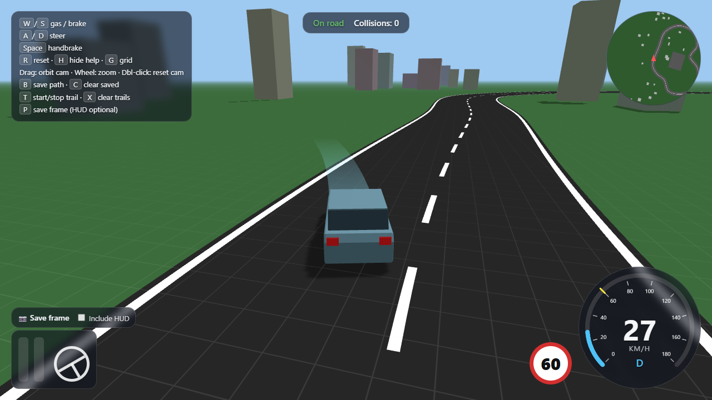

# Drive Sim

A 3D driving simulator in the browser, built for educational use (learning to drive, spatial awareness, vehicle control). It is deliberately simple and is improved step by step.

## Run it

There is no build step. The only dependency is [Three.js](https://threejs.org/), loaded from a CDN, so you need an internet connection.

Browsers block ES modules opened from `file://`, so serve the folder over HTTP:

```
python -m http.server 8000
```

Then open <http://localhost:8000>.

## Controls

| Input | Action |
| --- | --- |
| `W` / `↑` | Accelerate |
| `S` / `↓` | Brake / reverse |
| `A` `D` / `←` `→` | Steer |
| `Space` | Handbrake |
| `R` | Reset the car to the start |
| Mouse drag | Orbit the camera (right-click works too) |
| Mouse wheel | Zoom |
| Double-click | Reset the camera |
| `G` | Toggle the 1 m × 1 m ground grid |
| `H` | Hide or show the help panel |
| `B` / `C` | Bake the live path onto the ground / clear baked paths |
| `T` / `X` | Start or stop recording the driven path / clear recordings |
| `P` | Save a PNG of the current frame |

The camera eases back to the chase view while you drive.

## Features

- **Car:** compact hatchback (4.0 × 1.75 m, 2.55 m wheelbase) with spinning wheels, steering front wheels, headlights that glow while moving and brake lights.
- **Driving model:** arcade-style bicycle model with acceleration, drag, braking and reversing.
- **Steering:** the steering wheel angle is the single source of truth (up to 540° each way, 1.5 turns). The tyres, the car's turning and the HUD wheel all follow it. It turns at a limited rate, self-centres, and on keyboard it can't be turned as far at speed.
- **Collisions:** the car is a rotated rectangle tested against box obstacles; hits are counted.
- **Arena:** a closed ~570 m circuit with edge lines and a dashed centre line, a training lot with 12 parking bays and a cone slalom, and buildings placed around the track. The layout is the same every session.
- **HUD:** speedometer with a 60 km/h limit marker and sign, gear, rotating minimap, throttle/brake bars, steering wheel, on/off-road status and collision count.
- **Live path:** a ribbon as wide as the car showing where the front tyres will take it, assuming about 12 km/h forward and 7 km/h in reverse. It keeps its direction while stopped.
- **Baked and recorded paths:** `B` copies the live path onto the ground (orange). `T` records the path actually driven (green), so the two can be compared.
- **Frame export:** the Save frame button or `P` downloads a PNG. Tick *Include HUD* to capture the HUD too (loaded on demand from a CDN).

## Project layout

| File | Purpose |
| --- | --- |
| `index.html` | Page, HUD markup and the Three.js import map |
| `hud.css` | HUD styling |
| `main.js` | Scene, track, car, physics, camera, paths, HUD logic |
| `docs/` | README assets |

## Tuning

Most behaviour is controlled by constants near the top of the relevant section in `main.js`:

- `CAR` for car dimensions and `MAX_SPEED`, `ACCEL`, `BRAKE` and similar for the driving feel.
- `WHEEL_LOCK` and `MAX_STEER` for the steering wheel range and tyre angle.
- `trackCurve` for the circuit's control points and `TRACK_W` for its width.
- `PREVIEW_SPEED` and `PREVIEW_SPEED_REVERSE` for the live path; set them near your typical turning speed.

## Ideas for next steps

- Lesson layer: traffic lights, signs, lane and speed checks, with scoring.
- Cockpit camera for mirror and blind-spot checks.
- A road connecting the circuit to the training lot, intersections and pedestrians.
- Gamepad or steering wheel input.

## Screenshot


